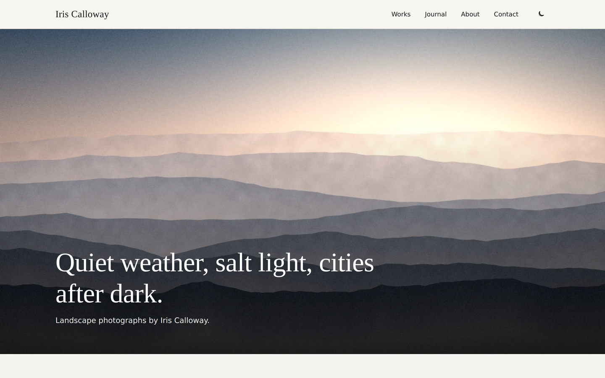
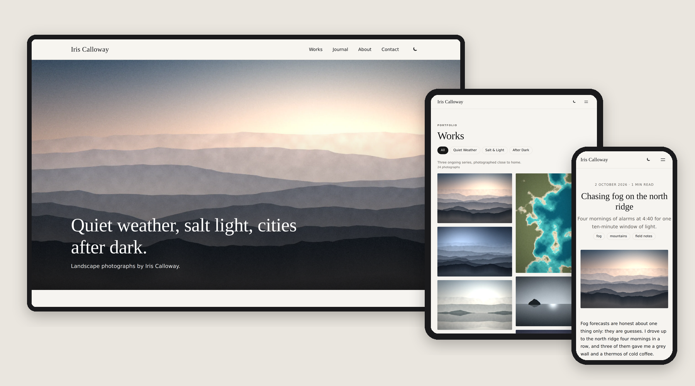
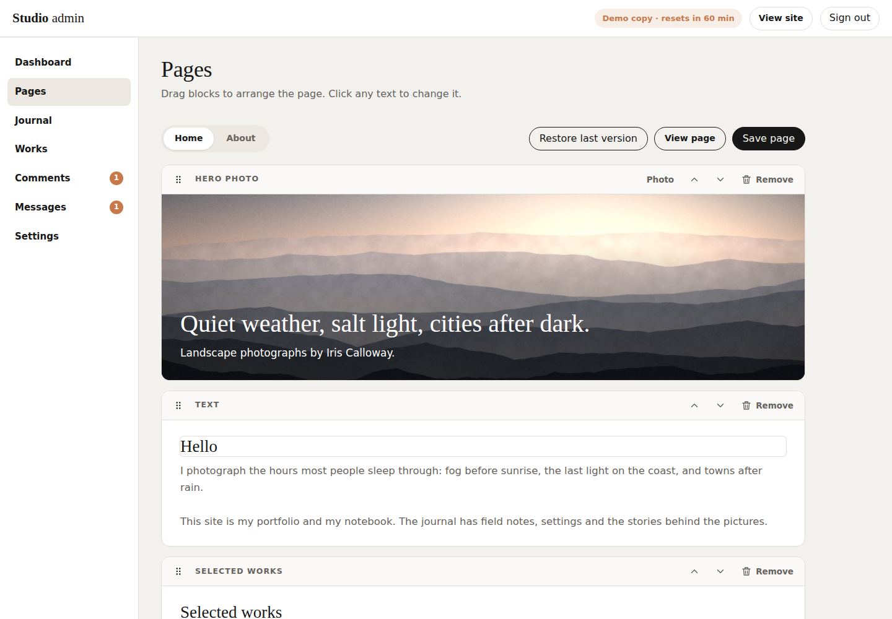
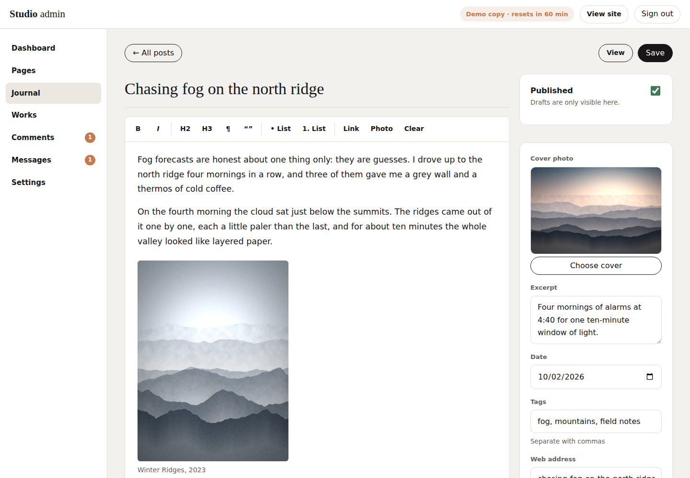
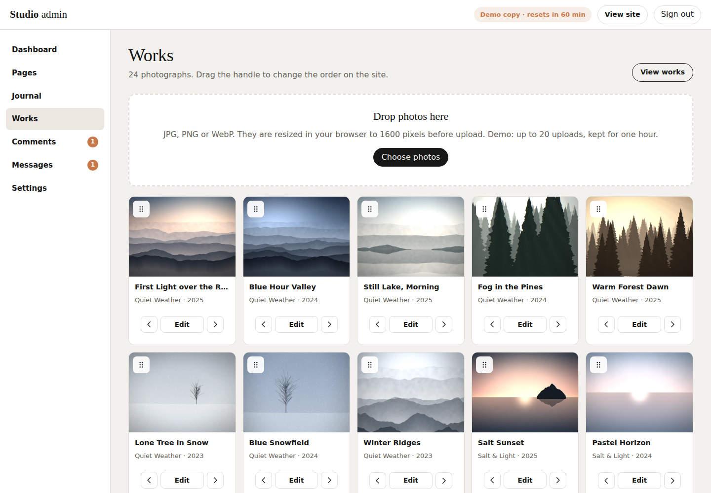
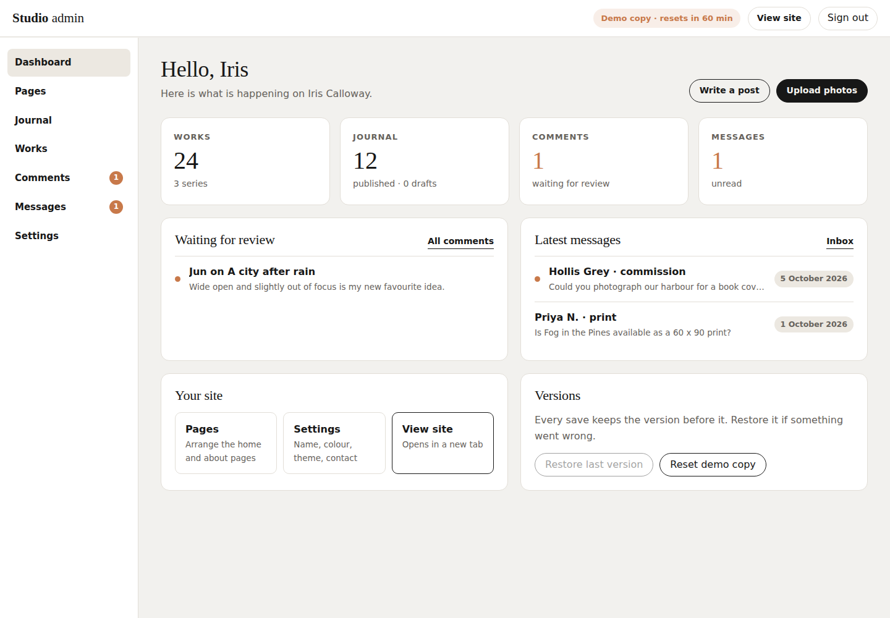

# Iris Calloway — SkyNet Artist Blog Template

A responsive photographer's portfolio and journal with a full admin site, for **ASP.NET Core (.NET 10)**, built on the **SkyNet Framework**.
Upload photographs, write posts, arrange pages by drag and drop and edit text in place — all saved to one JSON file, no database.
Free and open source. **100% AI-driven coding — built by Claude.**

[](https://dotnet.microsoft.com/)
[](https://www.nuget.org/packages/TheSkyLite.SkyNet)
[](LICENSE)
[](#100-ai-driven-coding)

**Live demo:** https://www.theskylite.com/ArtistBlog — admin: open **Admin** in the footer and sign in with `iris` / `demo`



> **Fictional photographer.** Iris Calloway and every photograph, post, comment and message on the site are invented for demonstration. The photographs are painted in code; no stock images.

---

## Features

### Public site — 6 pages

- **Home** and **About** built from blocks you arrange in the admin: hero photo, text, wide photo, quote, photo and text, selected works, latest posts, follow links and a contact call
- **Works:** masonry grid with series filters, and a full-screen viewer with previous / next, keyboard arrows and Esc
- **Journal:** tag chips, live search and Load more
- **Post:** cover photo, reading time, likes, comments (held for approval), older / newer and related posts
- **Contact:** a form checked on the server; messages go to the admin inbox
- **Social links:** Instagram, YouTube, X, Facebook, LinkedIn, TikTok, Pinterest, Threads, Behance, Flickr and Vimeo — icons under the footer menu, a Follow list on the contact page and an optional Follow block; empty links are hidden
- **Light and dark theme**, chosen in the admin; visitors can switch with the moon button
- **Responsive:** desktop, tablet and phone layouts with a slide-in menu on smaller screens

### Admin site — 8 pages

- **Sign in** with a SHA-256 password hash from `application.cfg`; failed attempts are throttled
- **Dashboard:** works, posts, comments waiting and unread messages; latest activity; **Restore last version**
- **Pages:** the layout editor
  - Drag blocks by the handle to reorder them, or use the up / down buttons
  - Click any heading, paragraph, caption or quote and type — what you see is the page
  - Add any of 9 block types, remove blocks, choose photos from the library, flip photo-and-text blocks, choose how many works or posts to show; Selected works shows featured photos, the newest, or one series
  - "Unsaved changes" marker and a warning before leaving the page
- **Journal:** list with Published / Drafts filters and search; editor with bold, italic, headings, quote, lists, links and photos in the text; cover picker, excerpt, date, tags, web address and a Published switch
  - The server keeps only safe formatting: scripts, event handlers, `javascript:` links, outside images and iframes are removed
- **Works:** drag-and-drop upload (photos are resized in the browser to 1600 px and a 720 px thumbnail), drag to reorder, ★ to feature a photo in Selected works, edit title / series / year / caption, delete, and manage series
  - The server accepts only real JPEG or WebP data (checked by content, not by name), up to 8 MB per file
  - A photo used by a post or a page block cannot be deleted until it is replaced
- **Comments:** Waiting, Approved and Hidden tabs; approve, hide, delete, approve all
- **Messages:** Open, Done and All; reading pane, reply by email, mark done, delete
- **Settings:** name, tagline, accent colour, theme, contact details and social links (https only, checked on the server) with a live preview; a tool that creates the password hash for `application.cfg`
- **Every save keeps the previous version** (`site.prev.json`), so one click undoes a mistake

### Live demo mode

With `app.app.runmode | 0` every visitor who signs in (or posts a comment or message) gets a **private copy of the site for one hour**.
Their changes and uploads appear only to them; after the hour the copy expires and is cleaned up automatically.
Limits per copy: 20 uploads, 8 MB per file, 60 MB in total.
The social accounts in the demo are placeholders: clicking an icon shows a note instead of leaving the site. In production mode the icons open the real profiles in a new tab.











- **Painted photographs:** 24 landscape "photographs" in three series (Quiet Weather, Salt & Light, After Dark) plus hero, portrait and studio images — 54 WebP files painted in code by Claude
- **No front-end build:** plain HTML, CSS and vanilla JavaScript; no npm, no bundler, no SPA framework
- **No database:** everything lives in `data/site.json`

---

## Getting started

**Requirements:** .NET 10 SDK and Visual Studio (or any editor with the `dotnet` CLI).

```bash
git clone https://github.com/hkim6000/SkyNet-ArtistBlogWebsite-Asp.net.Core-Full-Source.git
cd SkyNet-ArtistBlogWebsite-Asp.net.Core-Full-Source
dotnet run
```

Or open `ArtistBlog.csproj` in Visual Studio and press **F5**.
The SkyNet package (`TheSkyLite.SkyNet` 1.0.6) restores automatically from NuGet.
The app opens on **Home** — the startup page set in `appConfig/application.cfg`.

**Admin:** click **Admin** in the footer (or open `/AdminLogin`) and sign in with `iris` / `demo`.

---

## Run it for real (production mode)

1. **Create a password hash.** Sign in to the demo, open **Settings → Admin password**, type your password and click **Create hash**. Or in PowerShell:

   ```powershell
   $p = Read-Host "Password"; [BitConverter]::ToString([Security.Cryptography.SHA256]::Create().ComputeHash([Text.Encoding]::UTF8.GetBytes($p))).Replace("-","").ToLower()
   ```

2. **Edit `appConfig/application.cfg`:**

   ```
   app.app.runmode | 1
   app.admin.user | iris
   app.admin.passhash | <the 64-character hash>
   ```

3. **Give the site write access** to three folders. On IIS, grant the application pool identity (for example `IIS AppPool\ArtistBlog`) **Modify** permission on:

   | Folder | What is written |
   |---|---|
   | `data/` | `site.json` and `site.prev.json` (the previous version) |
   | `temp/` | admin sessions (`temp/admin`) and demo copies (`temp/sandbox`) |
   | `images/uploads/` | uploaded photographs and thumbnails |

4. **Use HTTPS.** The admin token travels in a cookie and in each admin request.

> **Redeploying:** publishing copies `data/site.json` from your project and overwrites the live one. Download the live `data/site.json` first (or exclude it from the publish) so you keep what you changed in the admin. `images/uploads/` and `temp/` are not published, but turn off "Remove additional files at destination" so they are not deleted.

In production mode admin sessions last 8 hours (renewed while you work); the demo copies and their limits are off.

---

## Project structure

```
ArtistBlog/
├── appConfig/application.cfg        app settings, run mode, admin user and password hash
├── codes/                           page classes (C#)
│   ├── Models/SiteModel.cs          data DTOs
│   ├── Home.cs  Works.cs  Journal.cs  Post.cs  About.cs  Contact.cs
│   └── AdminLogin.cs  Admin.cs  AdminLayout.cs  AdminPosts.cs  AdminWorks.cs  AdminComments.cs  AdminMessages.cs  AdminSettings.cs
├── htmls/  scripts/  styles/        page markup, JavaScript and CSS
├── data/site.json                   settings, series, works, posts, comments, messages and page blocks
├── images/
│   ├── works/full/  works/thumbs/   photographs (1600 px and 720 px, WebP)
│   ├── site/                        hero, portrait and studio images
│   └── uploads/                     photographs uploaded in the admin
├── temp/                            admin sessions and demo copies (created at run time)
├── Properties/launchSettings.json   hot reload off
└── Program.cs
```

### One page = four files, one name

| File | Holds |
|---|---|
| `codes/AdminLayout.cs` | the page class (`: WebPage`) and its server methods |
| `htmls/AdminLayout.html` | markup with `{plhd_*}` placeholders |
| `scripts/AdminLayout.js` | one IIFE namespace, `AdminLayoutJs` |
| `styles/AdminLayout.css` | styles, every class prefixed (`ay-`) |

Each page is self-contained: its own CSS prefix, its own script and its own C# methods.

---

## SkyNet in action

The browser calls a C# method; the method returns an `ApiResponse`; only those parts of the page change.

```js
// scripts/AdminLayout.js
api('Save', [{ key: 'pg', vlu: page }, { key: 'blocks', vlu: JSON.stringify(collect()) }]);
```

```csharp
// codes/AdminLayout.cs
public async Task<ApiResponse> Save()
{
    ApiResponse response = new ApiResponse();
    Session? s = await Auth();
    ...
    site.Pages.Home = clean;
    await SaveSite(site, s.Sbx, true);
    response.ExecuteScript("AdminLayoutJs.saved();");
    return response;
}
```

| Page | Request | Response |
|---|---|---|
| every public page | `Hydrate` | the page rebuilt from the visitor's demo copy, with its settings |
| Works | `Filter`, `Show` | series chips, count and grid; viewer with previous / next |
| Journal | `Filter` | tag chips, search results and Load more |
| Post | `Comment` | field errors, or "waiting for approval" |
| Contact | `Send` | field errors, or confirmation |
| AdminLogin | `SignIn` | error, or session token + demo copy |
| Admin | `Load`, `Undo`, `Reset` | dashboard; previous version restored; demo copy reset |
| AdminLayout | `Show`, `Add`, `Save`, `Undo` | page editor; a new block; saved; previous version |
| AdminPosts | `Edit`, `Save`, `Delete` | editor with photo picker; field errors or saved; list |
| AdminWorks | `Upload`, `Order`, `Edit`, `Save`, `Delete`, `SaveSeries` | grid; order saved; edit box; field errors; series |
| AdminComments | `Show`, `Act` | tab list; list + menu counts |
| AdminMessages | `Show`, `Act` | inbox and reading pane; list + menu counts |
| AdminSettings | `Save`, `Hash` | field errors or saved + new accent; password hash |

Learn more: [SkyNet Developer Guide](https://www.theskylite.com/documents/SkyNet_Developer_Guide.html)

---

## Customize it

- **In the admin:** name, tagline, colour, theme, contact details, pages, posts, photographs and series — no code needed
- **Starting content:** `data/site.json` holds everything the admin edits; replace it to ship your own defaults
- **Your own photographs:** upload them in **Works**, or replace the WebP files in `images/works/full/` and `images/works/thumbs/` (same names as the work ids)
- **Fonts and colours:** the CSS variables at the top of each stylesheet (`--hm-head`, `--hm-text`, `--hm-ink`, …); the accent colour comes from Settings
- **Demo limits:** `MaxUploads`, `MaxFile` and `MaxBox` in `codes/AdminWorks.cs`; the one-hour lifetime is the 60-minute check in `Sandbox()` and `Sweep()`

> Likes are counted in the visitor's browser (local storage) on top of each post's starting number. Comments and messages are stored in `site.json`; nothing is emailed.

---

## 100% AI-driven coding

Every file in this template — C#, HTML, CSS, JavaScript, the painted photographs and the data — was generated by Claude (Anthropic's AI) from a short instruction, directed and reviewed by the author.
No line was written by hand.

| | |
|---|---|
| Pages | 14 (6 public, 8 admin) |
| Lines of code | ~13,600 (C#, HTML, CSS, JavaScript) |
| Images | 54 painted WebP |
| Works / series / posts | 24 / 3 / 12 |
| Lines written by hand | 0 |

SkyNet's simple, predictable page model (one class, four files, `$ApiRequest` → `ApiResponse`) is what makes this possible:
the rules are few and consistent, so AI can generate complete, working pages with very few errors.

---

## License

- **This template** (all source files, artwork and data in this repository): [MIT License](LICENSE) — free to use, modify and redistribute, including commercially.
- **SkyNet Framework** (`TheSkyLite.SkyNet` NuGet package): proprietary, free to use including commercial use; see the license included in the package.

---

## Links

- Live demo: https://www.theskylite.com/ArtistBlog
- SkyNet Framework: https://www.theskylite.com
- NuGet package: https://www.nuget.org/packages/TheSkyLite.SkyNet
- SkyNet Agent (build your own site with Claude Code): https://github.com/hkim6000/SkyNet-Agent
- Template #1 — Beauty store: https://github.com/hkim6000/SkyNet-BeautyWebsite-Asp.net.Core-Full-Source
- Template #2 — Pharma company: https://github.com/hkim6000/SkyNet-PharmaWebsite-Asp.net.Core-Full-Source
- Template #3 — Travel blog: https://github.com/hkim6000/SkyNet-TravelWebsite-Asp.net.Core-Full-Source
- Template #4 — Fast food restaurant: https://github.com/hkim6000/SkyNet-FastFoodWebsite-Asp.net.Core-Full-Source
- Template #5 — Fine dining restaurant: https://github.com/hkim6000/SkyNet-FineDiningWebsite-Asp.net.Core-Full-Source
- Template #6 — Car dealership: https://github.com/hkim6000/SkyNet-CarDealerWebsite-Asp.net.Core-Full-Source
- Template #7 — Web comic: https://github.com/hkim6000/SkyNet-WebComicWebsite-Asp.net.Core-Full-Source
- Template #8 — Art gallery: https://github.com/hkim6000/SkyNet-ArtGalleryWebsite-Asp.net.Core-Full-Source
- SkyNet project template: https://github.com/hkim6000/ASPNETCoreEmpty.SkyNet

© 2026 HC Kim
